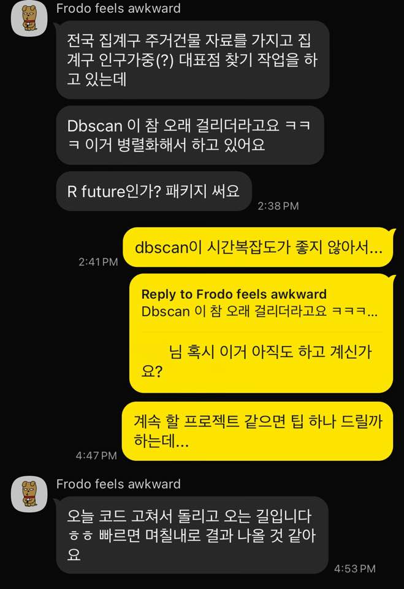

# Backdrop

{width=70%}


>[Frodo, 2:37 PM] I'm working on finding representative points for census tracts using nationwide residential building data, weighted by the population of each tract.<br>
[Frodo, 2:38 PM] But DBSCAN is taking forever lol, so I'm running it in parallel.<br>
[Frodo, 2:38 PM] Using something like the future package in R.<br>
[Yong-Hun Suh, 2:41 PM] Yeah, DBSCAN’s time complexity isn’t great…<br>
[Yong-Hun Suh, 4:47 PM] Are you still working on that (DBSCAN)?<br>
[Yong-Hun Suh, 4:47 PM] If it’s a project you’re going to continue, I can give you a tip…<br>
[Frodo, 4:53 PM] Just fixed the code and running it now haha, results should come out in a **few days** if it’s fast.<br>


A colleague from grad school was using DBSCAN to find representative points for census tracts from residential building data. He was already using a C++ implementation through R, but still expected to wait a few days for the results.

I thought, 'Why not help him out and turn this into a blog article?' The comparisons below use synthetic points and a sample of NYC taxi trips.


## How input size affects runtime


::: {.callout-tip}

## Reading the plot

Time complexity describes how an algorithm's computational cost grows with input size. Here, $n$ is input size and $N$ is a schematic operation count. These curves illustrate growth rates; they are not measured runtimes.

[Learn more](https://en.wikipedia.org/wiki/Time_complexity){target="_blank"}

:::


```{r, warning=FALSE}
#| fig-cap: "Comparison of computational growth rates"
#| fig-subcap: "Schematic growth rates, not measured runtimes."
#| fig-alt: "Curves comparing constant, logarithmic, linear, and faster growth rates"

library(data.table)
library(ggplot2)

# Seq `n` gen
n <- seq(0, 100, by = 0.01)  # need to make the increment small in order to avoid `Inf`s

# data.table
df <- data.table(
                  n = n,
                  `O(1)` = 1,
                  `O(log n)` = log2(n),
                  `O(n)` = n,
                  `O(n log n)` = n * log2(n),
                  `O(n^2)` = n^2,
                  `O(2^n)` = 2^n,
                  `O(n!)` = factorial(n)
                )

df_long <- data.table::melt(df, id.vars = "n", variable.name = "Complexity", value.name = "Time")

ggplot(df_long, aes(x = n, y = Time, color = Complexity)) +
      geom_line(size = 1.2) +
            ylim(1, 100) +
            xlim(1, 100)+
      labs(
            #title = "Compirison of Computational Complexity",
            x = "Input Size (n)",
            y = "Number of Operations (N)",
            color = "Complexity"
          ) +
      theme_minimal() +
      theme(
            plot.title = element_text(size = 16, face = "bold"),
            legend.title = element_text(size = 12),
            legend.text = element_text(size = 10)
      )

```


## DBSCAN time complexity

Much of the work in a conventional DBSCAN implementation is finding neighbors within a radius $\varepsilon$. In $d$-dimensional Euclidean space, one distance calculation takes $O(d)$ work. Checking all pairs of $n$ points therefore takes $O(n^2 \cdot d)$ work.

A spatial index can avoid many of those checks. How much it helps depends on the data and the search radius:

| Factor | Effect on runtime |
|---|---|
| Input size $n$ | More points mean more neighborhood queries. |
| Dimensionality $d$ | Each distance uses more coordinates, and index pruning can become less effective. |
| Radius $\varepsilon$ and local density | Larger or denser neighborhoods contain more points to inspect. |
| `minPts` | Changes which points are core points and how clusters expand. |
| Implementation | Search structures, memory use, and parallelism affect the cost of the same task. |

The R [`dbscan` package](https://www.jstatsoft.org/article/view/v091i01){target="_blank"} already uses C++ spatial indexing. It serves as the baseline for the comparisons below.

## Solution...? At least for this case :)

I tried [`dbscan-python`](https://github.com/wangyiqiu/dbscan-python){target="_blank"}, a Python interface to parallel C++ code for low-dimensional Euclidean data. It comes from Wang, Gu, and Shun's SIGMOD 2020 paper, [*Theoretically-Efficient and Practical Parallel DBSCAN*](https://doi.org/10.1145/3318464.3380582){target="_blank"}.

The package uses the available threads automatically. The comparisons below keep the input data and clustering parameters the same, but do not set matching thread limits.

So, back to Python for this experiment.

# Experiments

## Setup

### R packages

```{r warning=FALSE}

library(dbscan)


library(data.table)
library(arrow)
library(future.apply)


library(ggplot2)


```


### Python through reticulate

`reticulate` connects the R session to Python. This blog's build manages the Python environment with Pixi; the chunk below shows which executable is being used.

```{r}
library(reticulate)

# Python is provisioned centrally by Pixi using ci-packages.
# The One-pass renderer selects it before Quarto executes this document.

sys <- import("sys")

sys$executable

```


## Synthetic dataset

I generated two noisy semicircles with 100,000 points each. Both implementations use the same 200,000 coordinate pairs, with `eps = 0.08` and `minPts` / `min_samples = 200`.

```{r}


generate_random_semicircle <- function(center_x, center_y, radius, start_angle, end_angle, n_points = 100, noise = 0.08) {
    
      angles <- runif(n_points, min = start_angle, max = end_angle)
      x <- center_x + radius * cos(angles) + rnorm(n_points, 0, noise)
      y <- center_y + radius * sin(angles) + rnorm(n_points, 0, noise)
      
      return(as.data.table(list(x = x, y = y)))
}


set.seed(123)


N <- 1e+5L


semicircle1 <- generate_random_semicircle(center_x = 0, center_y = 0.25, radius = 1,
                                          start_angle = pi, end_angle = 2 * pi, n_points = N)
semicircle1[, group := "Semicircle 1"]


semicircle2 <- generate_random_semicircle(center_x = 1, center_y = -0.25, radius = 1,
                                          start_angle = 0, end_angle = pi, n_points = N)
semicircle2[, group := "Semicircle 2"]


df <- rbindlist(list(semicircle1, semicircle2))


# visualization
ggplot(df, aes(x = x, y = y, color = group)) +
  geom_point(size = 2) +
  coord_fixed(ratio = 1) +
  theme_minimal() +
  labs(title = "Randomized Overlapping Semicircles", x = NULL, y = NULL) +
  theme(legend.position = "none")


lab_data <- df[, !c("group"), with = FALSE]


```


### R — `dbscan`

```{r}
lab_data_r <- lab_data

epsilon <-  .08
minpts <- 200L #should be an integer for the python env


stime <- Sys.time()
db_result_r <- dbscan(lab_data_r, eps = epsilon, minPts = minpts)
etime <- Sys.time()

delta_t_r <- etime-stime; delta_t_r

# result
table(db_result_r$cluster)


lab_data_r$group <- as.factor(db_result_r$cluster)

# visualization
ggplot(lab_data_r, aes(x = x, y = y, color = group)) +
    geom_point(size = 2) +
    coord_fixed(ratio = 1) +
    theme_minimal() +
    labs(title = "Randomized Overlapping Semicircles", x = NULL, y = NULL) +
    theme(legend.position = "none")

```


### Python — `wangyiqiu/dbscan-python`

```{r}

lab_data_py <- lab_data

py$lab_data <- as.matrix(lab_data_py)
py$epsilon <- epsilon
py$minpts <- minpts

```


```{python}
import numpy as np
from dbscan import DBSCAN
import time

print("type(X):", type(lab_data))
print("shape(X):", getattr(lab_data, 'shape', None))


start = time.time()
labels, core_samples_mask = DBSCAN(lab_data, eps = epsilon, min_samples = minpts)
end = time.time()


delta_t = end - start

print(f"Elapsed time: {delta_t:.4f} seconds")


# 결과를 R로 반환
#r.labels = labels
#r.core_mask = core_samples_mask


```


```{r}

# result
table(py$labels)


lab_data_py$group <- as.factor(py$labels+1) # as index number starts from 0

# visualization
ggplot(lab_data_py, aes(x = x, y = y, color = group)) +
      geom_point(size = 2) +
      coord_fixed(ratio = 1) +
      theme_minimal() +
      labs(title = "Randomized Overlapping Semicircles", x = NULL, y = NULL) +
      theme(legend.position = "none")

```


### Results

The ratio below divides R's elapsed time by Python's elapsed time.

```{r}
#speedup


cat(delta_t_r[[1]]/py$delta_t," times speed-up\n",sep = "")


```


## NYC taxi data

For the second test, I used [NYC yellow taxi trip records](https://www.nyc.gov/site/tlc/about/tlc-trip-record-data.page) from January 2024. The code keeps trips with positive, non-missing distance and fare values, then samples 200,000 rows.

The two features are trip distance and fare amount, used in their original units. Both runs use `eps = 0.3` and `minPts` / `min_samples = 10`; the radius is measured in that two-variable feature space.

```{r}

months <- 1

urls <- paste0("https://d37ci6vzurychx.cloudfront.net/trip-data/yellow_tripdata_2024-",sprintf("%02d", 1:months),".parquet")


plan(multisession,workers = 2)

taxi_list <- future_lapply(urls, function(url) as.data.table(read_parquet(url))) |> rbindlist()

gc()

head(taxi_list)


# select numeric rows & filtering out NAs
taxi_numeric_dt <- taxi_list[
    trip_distance > 0 & fare_amount > 0 & !is.na(trip_distance) & !is.na(fare_amount),
    .(trip_distance, fare_amount)
]

rm(taxi_list)
gc()


taxi_numeric_dt_200k <- taxi_numeric_dt[sample(.N, 200000)]
#taxi_numeric_dt_10m <- taxi_numeric_dt[sample(.N, 10000000)]


py$taxi_numeric_dt_200k <- as.matrix(taxi_numeric_dt_200k)
#py$taxi_numeric_dt_10m <- as.matrix(taxi_numeric_dt_10m)

```


### R — `dbscan`

```{r}
epsilon <-  0.3
minpts <- 10L


stime <- Sys.time()
db_result_r <- dbscan(taxi_numeric_dt_200k, eps = epsilon, minPts = minpts)
etime <- Sys.time()

delta_t_r <- etime-stime; delta_t_r


table(db_result_r$cluster)


```


### Python — `wangyiqiu/dbscan-python`

```{r}

py$taxi_numeric_dt_200k <- as.matrix(taxi_numeric_dt_200k)
py$epsilon <- epsilon
py$minpts <- minpts

```


```{python}
import numpy as np
from dbscan import DBSCAN
import time

print("type(X):", type(taxi_numeric_dt_200k))
print("shape(X):", getattr(taxi_numeric_dt_200k, 'shape', None))


start = time.time()
labels, core_samples_mask = DBSCAN(taxi_numeric_dt_200k, eps=0.3, min_samples=10)
end = time.time()


delta_t = end - start

print(f"Elapsed time: {delta_t:.4f} seconds")


```


### Results

As a quick check, the code below compares the sorted counts of observations per label, including noise. This compares group sizes; matching counts alone would not establish that the same points were assigned to the same clusters.

```{r}

sort(as.vector(table(as.factor(py$labels)))) - sort(as.vector(table(as.factor(db_result_r$cluster))))


```

The counts differ slightly in the output shown here. This check does not identify the cause or tell us which points changed groups. Assessing agreement would require a point-level comparison that allows for different cluster label IDs.


```{r}
#speedup


cat(delta_t_r[[1]]/py$delta_t," times speed-up\n",sep = "")


```


The Python call was faster in this run. The ratio describes the two timed clustering calls on this sample.


# What I take from this

`dbscan-python` was faster in both examples shown here. For these inputs, changing the implementation reduced the clustering time while keeping the data and parameter values the same.

Each timing is a single run, and the timers cover only the clustering calls. Data loading, conversion between R and Python, and plotting are outside the timers. Thread counts are also uncontrolled, so the ratios reflect the implementations and hardware used here. A fuller benchmark would repeat the timings, control thread counts, and compare point-level cluster assignments.

# Environment info

```{r}
sessionInfo()
```


```{r}
if (Sys.info()[[1]]=="Windows") {
        
    # For my Windows Environment
    system("systeminfo",intern = T)
    
    
    } else{
    
    system("lscpu; free -h",intern = T)


    
}


```


