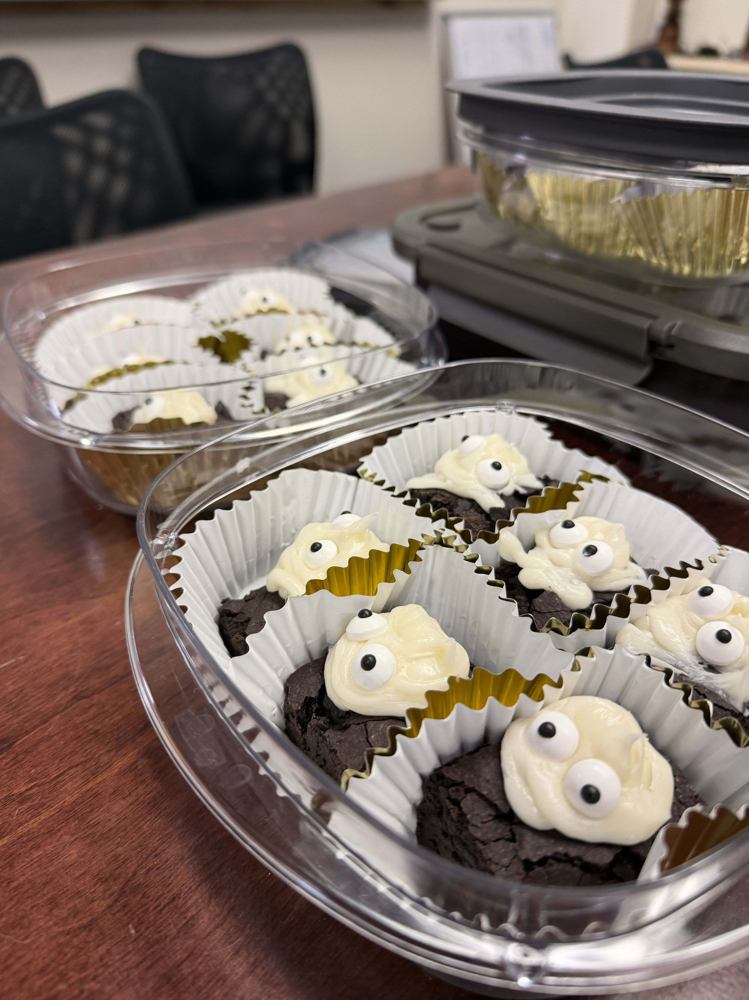
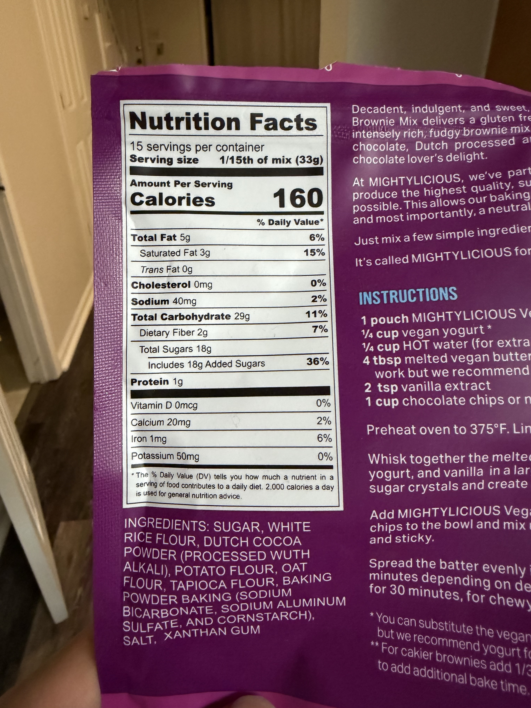
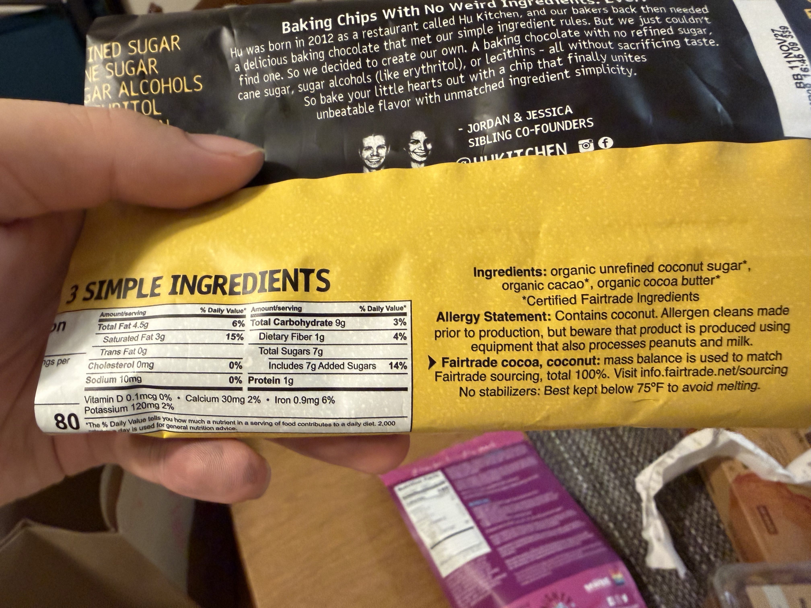
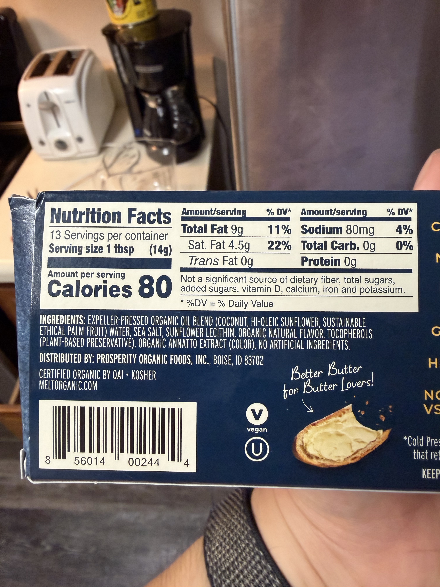
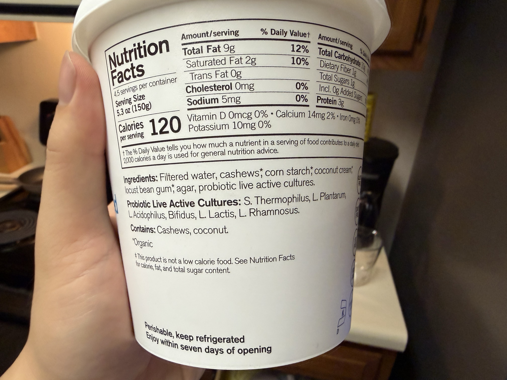
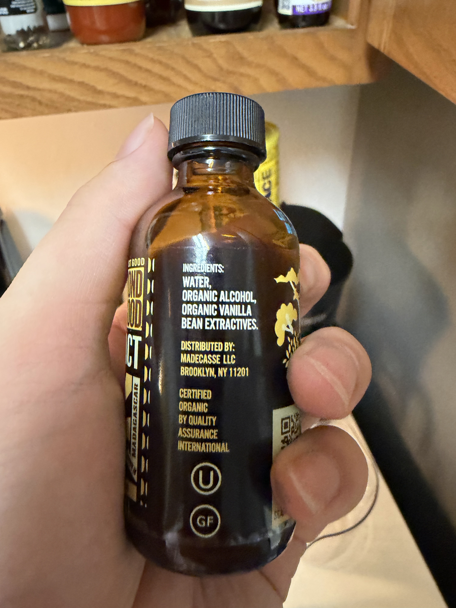
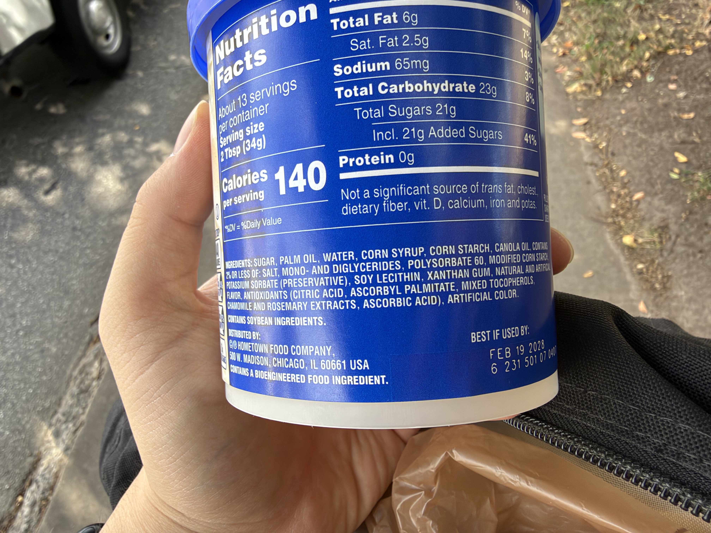
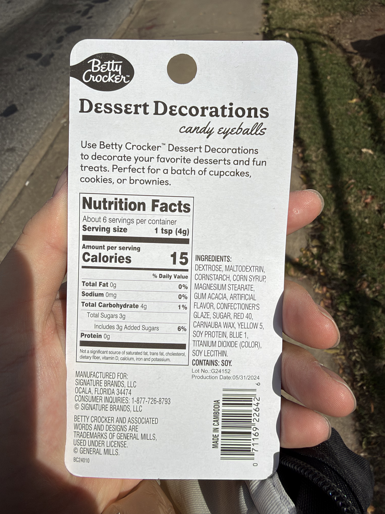

{fig-alt="Homemade Halloween brownies" width="85%"}

I baked brownies last night to bring in for Halloween, using **MIGHTYLICIOUS brownie mix**, **Hu Kitchen chocolate chips**, **Melt Organic plant-based butter**, vegan yogurt, water, and vanilla extract. No eggs or dairy added to the recipe, and I thought a few extra chocolate chips wouldn't hurt.

The decorating didn't go quite as planned. My grocery delivery was late, and the organic frosting I'd ordered was replaced with **Pillsbury Creamy Supreme Vanilla**. So I packed the brownies into paper muffin liners, brought the frosting and **Betty Crocker candy eyes** along, and left the decorating for later.

I kept two options: plain brownies and ones with Halloween decorations.

## What went into them

Here are the ingredient labels I photographed, in case you'd like to check something.

::: {layout-ncol=2}

:::

**Allergy note:** The chocolate chips and plant butter contain **coconut**; Hu's chips also have a shared-equipment warning for **milk and peanuts**. The frosting and candy eyes contain **soy**. The candy eyes contain confectioner's glaze, so I wouldn't call the decorated brownies vegan. Everything was made in a home kitchen, so I can't guarantee against cross-contact—please check the labels if you have a food allergy.

Happy Halloween!
